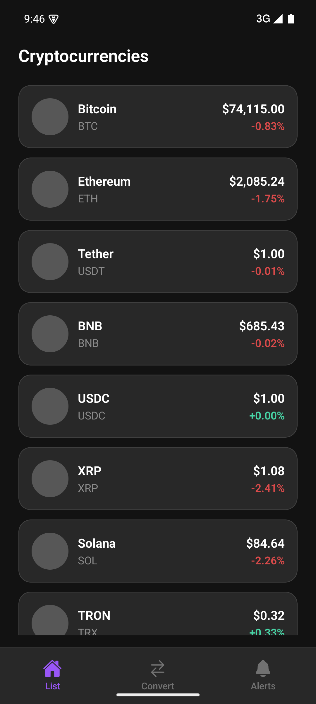
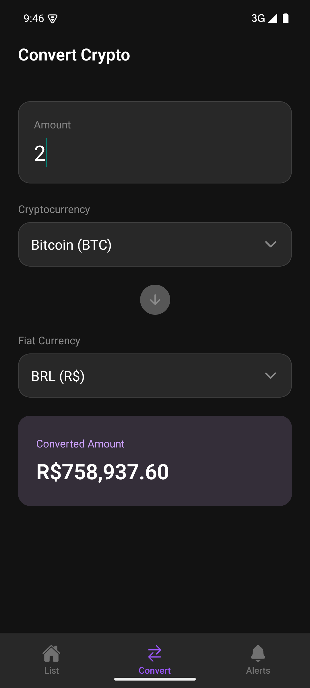
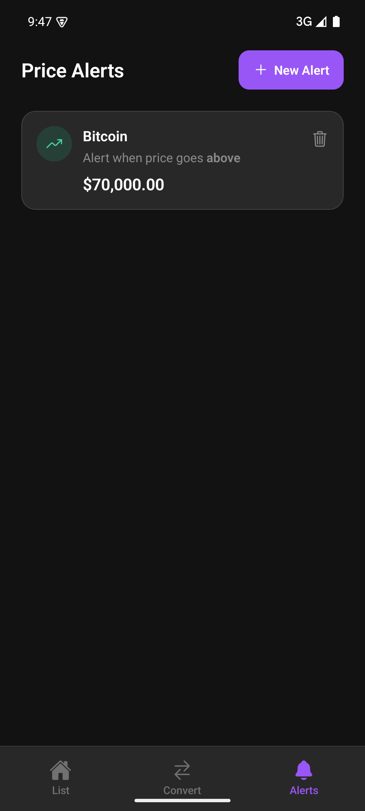
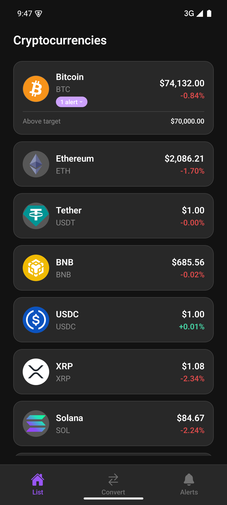
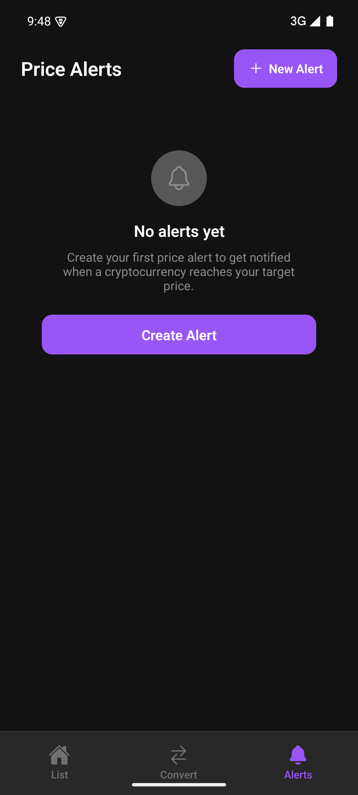
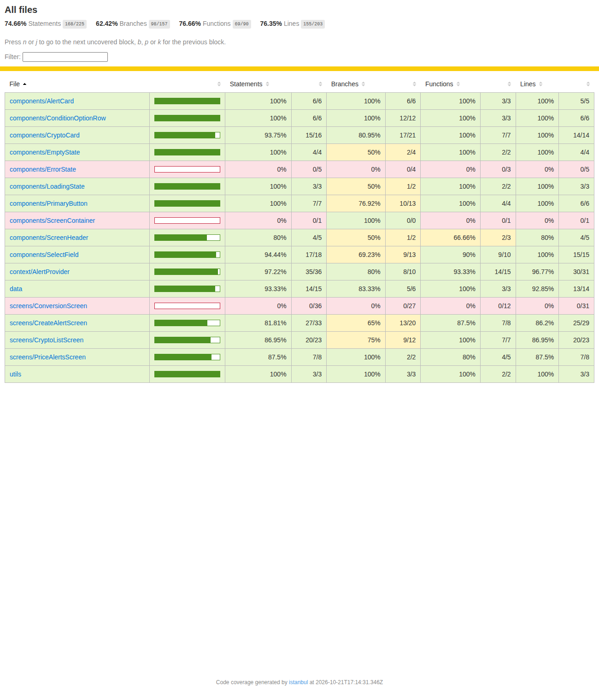

# Crypto Alert — Testes Automatizados

Testes automatizados para o projeto [React Native Crypto Alert](https://github.com/rocketseat-education/react-native-crypto-alert):

- **Testes E2E** com [Maestro](https://maestro.mobile.dev/), rodando no app nativo instalado no emulador Android (pasta `.maestro`).
- **Testes unitários e de integração** com **Jest** (`jest-expo`) e **React Native Testing Library**.

Outros arquivos da atividade: [`reflexao.md`](reflexao.md) (leitura do artigo GenIA-E2ETest) e [`ia/planejamento.md`](ia/planejamento.md) (planejamento dos cenários com IA).

## Instalação

```bash
npm install
```

Para rodar o app (opcional), copie `.env.example` para `.env` e coloque sua chave da API da [CoinGecko](https://www.coingecko.com/) em `EXPO_PUBLIC_COINGECKO_API_KEY`. Os testes **não** precisam da chave, porque não fazem chamadas reais à API.

## Testes E2E com Maestro

### Pré-requisitos

- Node.js e as dependências instaladas (`npm install`).
- Android Studio com o Android SDK e um emulador (AVD) criado. Também funciona com um aparelho físico com depuração USB.
- JDK 17 com `JAVA_HOME` configurado (o Android Studio já traz um em `jbr/`).
- Maestro instalado:

```bash
curl -fsSL "https://get.maestro.mobile.dev" | bash
maestro --version
```

### 1. Abrir o emulador

Pelo Android Studio (**Device Manager → ▶**) ou pelo terminal:

```bash
emulator -list-avds          # lista os emuladores criados
emulator -avd <NOME_DO_AVD>  # inicia o emulador
adb devices                  # deve mostrar "emulator-5554  device"
```

### 2. Gerar e instalar o app nativo

O app precisa estar instalado no emulador **antes** de rodar o Maestro. O pacote é `com.cryptoalert.app`.

```bash
npm run android
```

O comando gera a pasta `android/`, compila e instala o app. Também dá para gerar um APK de release e instalar manualmente:

```bash
npx expo prebuild --platform android
cd android && ./gradlew assembleRelease && cd ..
adb install -r android/app/build/outputs/apk/release/app-release.apk
```

A chave da CoinGecko (`.env`) é opcional. Sem ela, a API pública também responde, mas com limite menor de requisições.

### 3. Executar os testes

Com o emulador aberto e o app instalado, na raiz do projeto:

```bash
maestro test .maestro/                              # todos os fluxos
maestro test .maestro/03_criar_alerta.yaml          # um fluxo específico
```

Resultado esperado:

```
[Passed] Listar criptomoedas
[Passed] Converter criptomoeda
[Passed] Criar alerta de preço
[Passed] Excluir alerta

4/4 Flows Passed
```

> Se o emulador acabou de ligar e aparecer o aviso "System UI isn't responding", toque em **Wait** antes de rodar os testes.

### Fluxos implementados

| Arquivo | O que é validado |
|---|---|
| `.maestro/01_listar_criptomoedas.yaml` | A lista carrega da API com nome, símbolo, preço em dólar e variação de 24h. |
| `.maestro/02_converter_moeda.yaml` | Valor `0` mostra "Invalid amount"; um valor válido mostra o resultado em USD; trocar para BRL muda o símbolo para `R$`. |
| `.maestro/03_criar_alerta.yaml` | O botão "Save Alert" fica desabilitado sem dados; cria um alerta "above" de $70,000.00 para o Bitcoin; o indicador "1 alert" aparece na aba List. |
| `.maestro/04_excluir_alerta.yaml` | Cria um alerta "below" para o Ethereum, exclui pela lixeira e volta ao estado "No alerts yet". |

Todos os fluxos usam `launchApp` com `clearState: true`, então podem ser rodados em qualquer ordem.

### Evidências da execução

Vídeo do fluxo de criar alerta: [`docs/maestro/03_criar_alerta.mp4`](docs/maestro/03_criar_alerta.mp4)

| Lista | Conversão | Alerta criado | Indicador na lista | Alerta excluído |
|---|---|---|---|---|
|  |  |  |  |  |

## Testes unitários e de integração (Jest)

### Executar os testes

```bash
npm test
```

### Gerar a cobertura

```bash
npm run test:coverage
```

O relatório HTML é gerado em `coverage/index.html`.

### Testes criados

São 8 testes, dois em cada categoria:

| Categoria | Arquivo | O que é validado |
|---|---|---|
| Funções puras | `src/utils/__tests__/format.test.ts` | `formatPrice` (milhar, casas decimais, zero, `NaN`) e `formatChange` (sinal `+` em positivos e zero, `-` em negativos). |
| Componentes | `src/components/__tests__/components.test.tsx` | `AlertCard` exibe nome, condição e preço, e chama `onDelete` com o id. `PrimaryButton` exibe o rótulo, fica desabilitado sem disparar `onPress` e dispara quando está habilitado. |
| Hook | `src/screens/CryptoListScreen/__tests__/useCryptoListScreen.test.ts` | Estado inicial `loading`, depois `idle` com os dados da API mapeados (símbolo em maiúsculas, variação nula vira `0`). Erro da API leva ao estado `error`, e `handleRetry` recupera. |
| Fluxos completos | `src/__tests__/flows.test.tsx` | **Criar alerta:** escolhe a moeda, digita o preço, marca "Below", salva, vê o alerta na lista, confirma que foi persistido e exclui. **Listagem:** moedas vindas da API com preço e variação, e o badge "1 alert" de um alerta salvo, que ao ser tocado mostra os detalhes. |

#### Mocks (apenas limites externos)

- `fetch` (API CoinGecko): `jest.spyOn(global, "fetch")` em cada teste.
- `AsyncStorage`: mock oficial da biblioteca, em memória (`jest.setup.js`).
- `expo-router`: `router.push/replace/back` viram `jest.fn()` (`jest.setup.js`).

Componentes, hooks, `AlertProvider` e regras de validação continuam reais.

### Cobertura

| Statements | Branches | Functions | Lines |
|---|---|---|---|
| 74.66% | 62.42% | 76.66% | 76.35% |



O relatório completo em texto está em [`docs/coverage-report.txt`](docs/coverage-report.txt).
