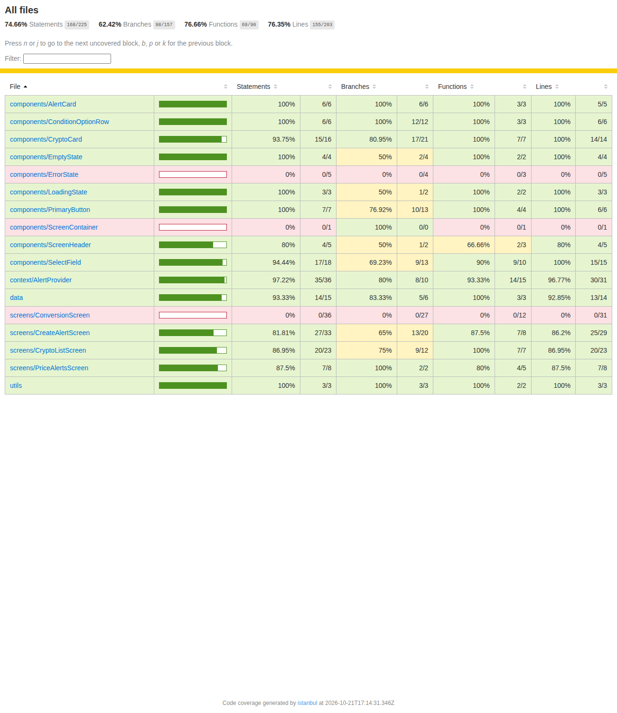

# Crypto Alert — Testes Automatizados

Suíte de testes automatizados para o projeto [React Native Crypto Alert](https://github.com/rocketseat-education/react-native-crypto-alert), usando **Jest** (`jest-expo`) e **React Native Testing Library**.

## Instalação

```bash
npm install
```

Para rodar o app (opcional), copie `.env.example` para `.env` e coloque sua chave da API da [CoinGecko](https://www.coingecko.com/) em `EXPO_PUBLIC_COINGECKO_API_KEY`. Os testes **não** precisam da chave, porque não fazem chamadas reais à API.

## Executar os testes

```bash
npm test
```

## Gerar a cobertura

```bash
npm run test:coverage
```

O relatório HTML é gerado em `coverage/index.html`.

## Testes criados

São 8 testes, dois em cada categoria:

| Categoria | Arquivo | O que é validado |
|---|---|---|
| Funções puras | `src/utils/__tests__/format.test.ts` | `formatPrice` (milhar, casas decimais, zero, `NaN`) e `formatChange` (sinal `+` em positivos e zero, `-` em negativos). |
| Componentes | `src/components/__tests__/components.test.tsx` | `AlertCard` exibe nome, condição e preço, e chama `onDelete` com o id. `PrimaryButton` exibe o rótulo, fica desabilitado sem disparar `onPress` e dispara quando está habilitado. |
| Hook | `src/screens/CryptoListScreen/__tests__/useCryptoListScreen.test.ts` | Estado inicial `loading`, depois `idle` com os dados da API mapeados (símbolo em maiúsculas, variação nula vira `0`). Erro da API leva ao estado `error`, e `handleRetry` recupera. |
| Fluxos completos | `src/__tests__/flows.test.tsx` | **Criar alerta:** escolhe a moeda, digita o preço, marca "Below", salva, vê o alerta na lista, confirma que foi persistido e exclui. **Listagem:** moedas vindas da API com preço e variação, e o badge "1 alert" de um alerta salvo, que ao ser tocado mostra os detalhes. |

### Mocks (apenas limites externos)

- `fetch` (API CoinGecko): `jest.spyOn(global, "fetch")` em cada teste.
- `AsyncStorage`: mock oficial da biblioteca, em memória (`jest.setup.js`).
- `expo-router`: `router.push/replace/back` viram `jest.fn()` (`jest.setup.js`).

Componentes, hooks, `AlertProvider` e regras de validação continuam reais.

## Cobertura

| Statements | Branches | Functions | Lines |
|---|---|---|---|
| 74.66% | 62.42% | 76.66% | 76.35% |



O relatório completo em texto está em [`docs/coverage-report.txt`](docs/coverage-report.txt).
